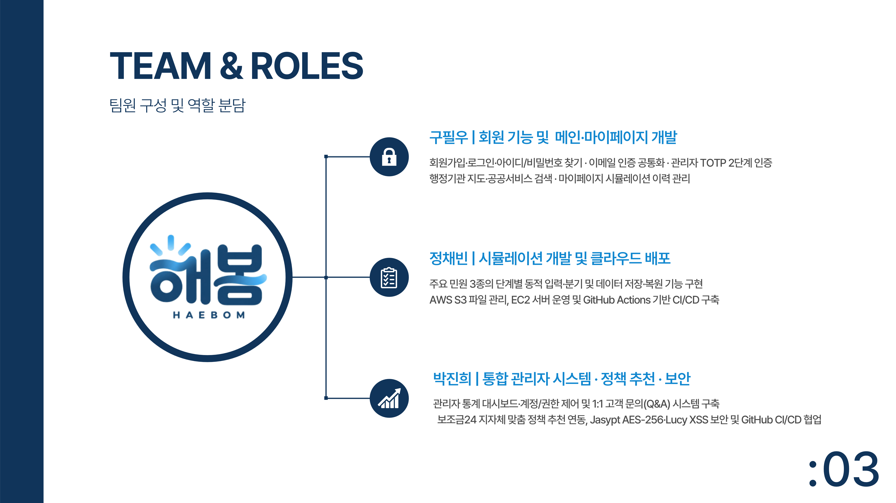
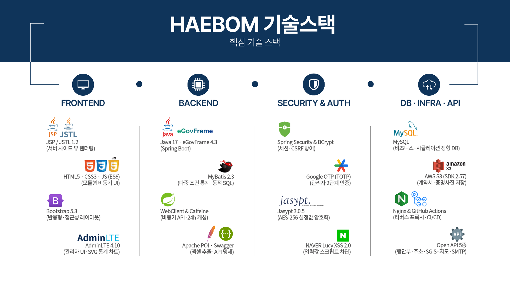
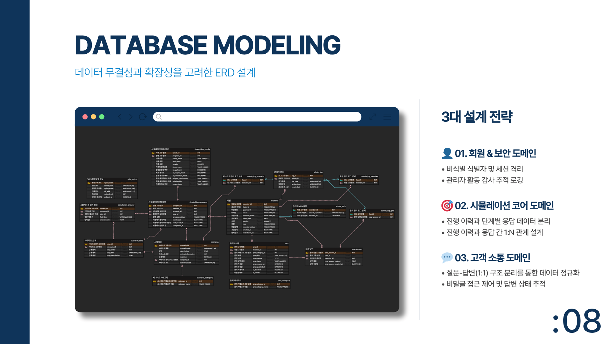
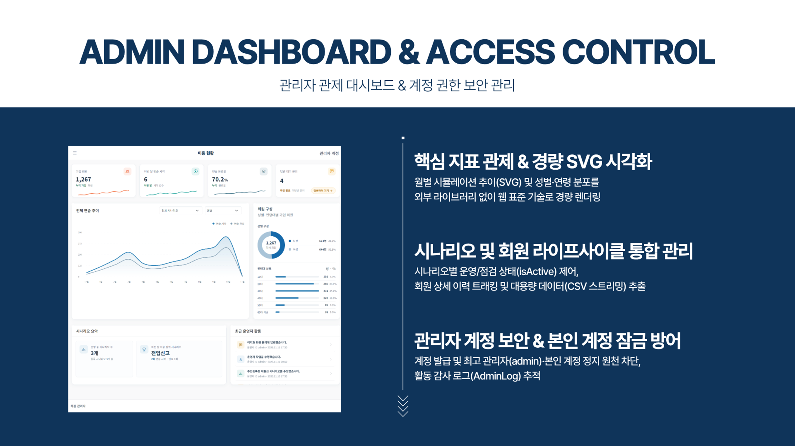
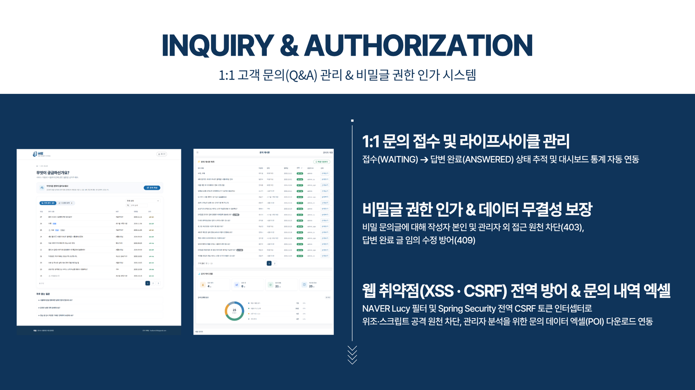
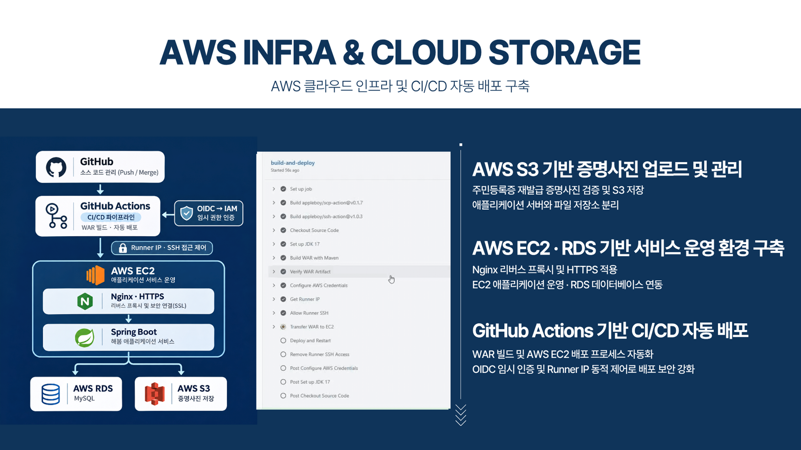
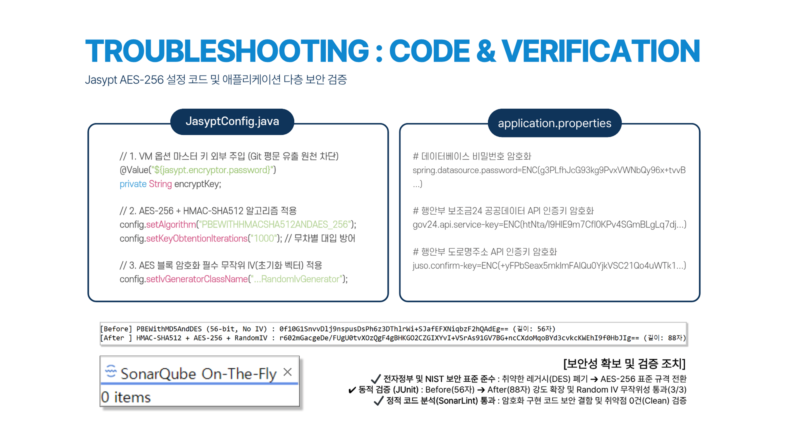

<div align="center">

# 🏛️ 해봄 (HAEBOM)
### 처음이라 막막한 공공 행정, 미리 연습 '해봄'
**공공 행정 시뮬레이션 & 지자체 맞춤 정책 연계 플랫폼**

<br/>


<br/>

[](https://www.oracle.com/java/)
[](https://spring.io/projects/spring-boot)
[](https://www.egovframe.go.kr/)
[](https://www.mysql.com/)
[](https://aws.amazon.com/)
[](LICENSE)

</div>

<br/>

---

## 📌 목차
1. [프로젝트 개요](#1-프로젝트-개요)
2. [팀원 구성 및 역할](#2-팀원-구성-및-역할)
3. [기술 스택](#3-기술-스택)
4. [시스템 아키텍처 및 데이터 모델링](#4-시스템-아키텍처-및-데이터-모델링)
5. [주요 기능](#5-주요-기능)
6. [기술적 트러블슈팅 및 최적화](#6-기술적-트러블슈팅-및-최적화)
7. [실행 가이드](#7-실행-가이드)
8. [발표 자료](#8-발표-자료)

---

<br/>

## 1. 프로젝트 개요

### 1) 기획 배경

- 정부24를 통한 온라인 민원 서비스가 일상화되었지만, 생소한 공공 행정 용어와 복잡한 신청 요건으로 인해 디지털 취약계층의 진입 장벽이 여전히 높습니다.
- 실제 정부24에서는 한 번의 입력 실수가 공식 민원 접수로 이어지기 때문에 부담 없이 연습해볼 수 있는 공간이 부족하며, 결국 주민센터를 직접 방문하게 되는 비효율이 발생합니다.

### 2) 서비스 목표

- 실제 정부24의 민원 신청 흐름을 기반으로, 법적 효력이나 실수 부담 없이 자유롭게 연습할 수 있는 안전한 시뮬레이션 환경을 제공합니다.
- 단순 모의체험에 그치지 않고, 사용자가 입력한 거주 지역 데이터를 바탕으로 놓치기 쉬운 지자체 맞춤 지원 혜택을 실시간 발굴·추천합니다.

---

<br/>

## 2. 팀원 구성 및 역할



| 팀원 | 역할 | 담당 업무 및 핵심 기여 내용 |
| :--- | :---: | :--- |
| **구필우** | **회원 & 사용자 플랫폼** | • 회원가입, 로그인, 아이디/비밀번호 찾기, 이메일 인증 공통화 (`EmailCodeService`)<br/>• Google Authenticator (TOTP) 기반 관리자 2단계 보안 인증 구현<br/>• 카카오 맵 REST API 기반 지역별 행정기관 조회 및 마커 필터링<br/>• 마이페이지 시뮬레이션 진행 이력 관리 및 저장/복원 |
| **정채빈** | **모의체험 엔진 & 인프라** | • 주요 민원 3종(전입신고, 신분증 재발급, 등본 발급) 단계별 동적 분기 및 폼 상태 관리<br/>• AWS S3 SDK 연동을 통한 계약서·증명사진 안전 업로드 및 검증<br/>• AWS EC2, RDS 운영 및 GitHub Actions OIDC 기반 CI/CD 무중단 자동 배포 파이프라인 구축 |
| **박진희** | **통합 관리자 · 정책 추천 · 다층 보안** | • 관리자 통계 대시보드 구축 및 순수 SVG 반응형 추이 차트 구현, 본인 계정 잠금 방어<br/>• 1:1 고객 문의(Q&A) 비밀글 403 인가 통제 및 409 무결성 방어, POI 엑셀 다운로드<br/>• 보조금24 지자체 맞춤 정책 추천 엔진 구축 (1·2순위 정밀 필터링, Fallback 안전망, 무상태 시드 난수)<br/>• 네이버 루시(Lucy) XSS 서블릿 필터 전역 방어, Jasypt AES-256 마이그레이션 및 JUnit/SonarLint 이중 검증 |

---

<br/>

## 3. 기술 스택



| 분류 | 기술 스택 | 상세 활용 내용 |
| :--- | :--- | :--- |
| **Backend** | `Java 17`, `eGovFrame 4.3.0`, `Spring Boot 2.7.x`, `MyBatis 2.3`, `WebClient`, `Caffeine Cache`, `Apache POI 5.2`, `Swagger 1.8` | 전자정부 표준 프레임워크 4.3 기반 비즈니스 로직, 비동기 API 통신 및 24시간 지역 코드 캐싱, 관리자 엑셀 보고서 생성 |
| **Frontend** | `JSP/JSTL 1.2`, `Apache Tiles 3.0`, `HTML5 / CSS3 / JavaScript (ES6)`, `Bootstrap 5.3`, `AdminLTE 4.10`, `SVG` | 반응형 모바일·데스크톱 레이아웃, 모듈형 모의체험 폼 UI, 라이브러리 프리 경량 SVG 통계 차트 |
| **Security & Auth** | `Spring Security`, `BCrypt`, `Jasypt 3.0.5 (AES-256)`, `NAVER Lucy XSS Filter 2.0`, `Google TOTP 1.7` | 비밀번호 및 공공 API 키 단방향/양방향 암호화, 요청 최전선 XSS 스크립트 전역 정제, CSRF 토큰 인터셉터, 관리자 2단계 MFA |
| **DB & Infra** | `MySQL 8.0`, `AWS EC2`, `AWS S3`, `AWS RDS`, `Nginx (Reverse Proxy & SSL)`, `GitHub Actions` | 정형 데이터 관리 및 관계 정규화, 클라우드 객체 스토리지, OIDC 임시 권한 기반 자동 빌드/배포 |
| **Open APIs** | `행정안전부 보조금24 API`, `도로명주소 검색 API`, `통계청 SGIS 지리정보 API`, `카카오 맵 API`, `Gmail SMTP` | 실시간 맞춤 정책 연계, 주소 정제, 행정동 경계 매핑, 행정기관 지도 렌더링, 인증코드 메일 발송 |

---

<br/>

## 4. 시스템 아키텍처 및 데이터 모델링

### 1) 시스템 아키텍처

- **Client**: 사용자 및 관리자 브라우저에 경량 SVG 및 반응형 인터페이스 제공
- **Nginx**: SSL/HTTPS 암호화 통신 및 리버스 프록시 포트 포워딩 중계
- **Security**: 서블릿 필터(NAVER Lucy) 최전선 XSS 전수 차단 및 Spring Security 세션 인가, 관리자 TOTP 2단계 인증
- **Backend**: eGovFrame 4.3 기반 비즈니스 엔진, WebClient 비동기 통신 및 24시간 Caffeine 캐싱
- **Storage**: MySQL 정형 데이터베이스 및 AWS S3 파일 스토리지 격리 운영

### 2) 데이터 모델링 (ERD)

- **회원 & 보안 도메인**: 비식별 식별자 분리 및 세션 격리, 관리자 활동 감사 추적 로깅 (`admin_log`)
- **시뮬레이션 코어 도메인**: 진행 이력(`simulation_progress`)과 단계별 응답 데이터(`simulation_answer`)를 1:N으로 정규화 분리하여 중단 후 이어하기 및 단계별 복원 보장
- **고객 소통 도메인**: 문의글(`qna`)과 답변(`qna_answer`)을 1:1 구조로 물리 분리하여 데이터 무결성 및 답변 상태 추적 보장

---

<br/>

## 5. 주요 기능

### 1) 행정절차 모의체험 엔진

- **핵심 민원 3종 시뮬레이션**: 전입신고, 주민등록증 재발급, 등본·초본 발급 등 생활 밀착형 공공 행정 절차 구현
- **동적 분기 & 이어하기**: 사용자 선택 조건에 따른 맞춤형 폼 구성 및 단계별 데이터 임시 저장·복원 지원
- **실시간 접수증 발급**: 시뮬레이션 완료 시 실제 행정 양식 기반의 실시간 PDF 접수증 출력 제공

### 2) 통합 관리자 관제 대시보드 & 계정 보안

- **라이브러리 프리 SVG 차트**: 외부 무거운 라이브러리 없이 웹 표준 3차 베지어 곡선(C 커맨드)으로 렌더링한 경량 통계 차트
- **대용량 I/O 스트리밍**: 대용량 회원 데이터 다운로드 시 서버 메모리 고갈(OOM)을 방지하는 CSV I/O 스트리밍 처리
- **관리자 계정 자기보호**: 최고 관리자(admin) 및 접속 중인 본인 계정의 비활성화 시도 원천 차단 (`403 Forbidden`)
- **감사 로그 추적**: 관리자 활동 내역(`admin_log`) 실시간 기록 및 감사 추적 체계 구축

### 3) 1:1 고객 문의(Q&A) & 권한 인가 시스템

- **비밀글 인가 통제**: 작성자 본인 및 관리자 외 비밀 문의글 접근 차단 (`403 Forbidden`)
- **답변 무결성 보장**: 관리자 답변이 완료된 문의글의 사용자 임의 수정 및 삭제 방어 (`409 Conflict`)
- **보고서 엑셀 내보내기**: 관리자 분석 및 보고 업무를 위한 Apache POI 기반 다중 스타일 엑셀 다운로드 연동

### 4) 시뮬레이션 연계 지자체 맞춤 정책 추천 엔진

- **공공 API 실시간 연동**: 행안부 보조금24 Open API 연계를 통한 이사 지역 기반 맞춤 정책 자동 수집
- **2단계 정밀 지역 필터링**: 시·군·구 1순위, 광역 시·도 2순위 정밀 필터링으로 타 지자체 정책 혼선 방지
- **무상태(Stateless) 시드 난수**: 시뮬레이션 ID 기반 시드 난수 설계로 새로고침 및 PDF 인쇄 시 일관된 결과 보장
- **Fallback 안전망**: 공공 API 지연·장애 발생 시 실존 공공 정책 5종(LH, HUG 등)으로 즉시 전환되는 장애 격리 체계

### 5) 회원 공통 인증 & 관리자 2단계 인증 (TOTP)

- **인증 로직 공통 컴포넌트화**: 회원가입, 아이디/비밀번호 찾기 메일 인증 로직을 단일 서비스(`EmailCodeService`)로 추상화
- **무차별 대입 및 남용 방어**: 유효시간(5분), 최대 입력 횟수(5회), 재전송 간격(30초) 및 IP 발송량 제한 적용
- **관리자 2단계 MFA (TOTP)**: 관리자 로그인 시 RFC 6238 기반 Google Authenticator 2단계 보안 인증 연동

### 6) AWS 클라우드 인프라 & CI/CD 자동화

- **보안 파일 스토리지 (S3)**: AWS S3 SDK 연동을 통한 증명사진 및 임대차 계약서 안전 업로드 및 격리
- **무중단 CI/CD 파이프라인**: GitHub Actions 기반 WAR 빌드 및 AWS EC2 자동 배포 체계 구축
- **OIDC 보안 강화**: 장기 AWS 자격증명 노출을 원천 방지하는 GitHub Actions OIDC 기반 임시 자격증명 연동

---

<br/>

## 6. 기술적 트러블슈팅 및 최적화

### 1) Jasypt 암호화 규격 AES-256 마이그레이션 및 정적·동적 이중 검증


- **문제 배경**: Jasypt 기본 `PBEWithMD5AndDES` 알고리즘의 56비트 암호화 한계 및 공공 보안 규격 미달 경고
- **기술적 조치**: 전자정부 및 NIST 표준인 `PBEWITHHMACSHA512ANDAES_256` 규격 전환 및 `RandomIvGenerator` 무작위 난수 적용
- **보안 격리**: 마스터 키는 이클립스 실행 VM 옵션(`-Djasypt.encryptor.password`)으로 외부 주입하여 Git 평문 유출 차단
- **이중 검증**: JUnit 단위 테스트(암호문 56자 ➔ 88자 확장, 무작위성 3/3 통과) 및 SonarLint 정적 분석 결함 0건(Clean) 완료

### 2) 웹 취약점(XSS) 최전선 전역 방어 아키텍처
- **문제 배경**: 컨트롤러마다 일일이 검증할 경우 개발자의 실수로 인한 누락 위험 존재
- **기술적 조치**: 스프링 진입 전 서블릿 최전선에서 동작하는 NAVER Lucy XSS 서블릿 필터를 전역 적용하여 악성 스크립트 강제 치환
- **보안 보완**: Spring Security 전역 CSRF 토큰 인터셉터를 연동하여 다층 웹 보안 체계 확립

### 3) 대용량 데이터 메모리 고갈(OOM) 방어 & I/O 스트리밍
- **문제 배경**: Apache POI 엑셀 다운로드 방식은 셀 객체를 힙 메모리에 적재하여 대규모 데이터 시 OOM 위험 발생
- **기술적 조치**: 메모리 버퍼를 즉시 비우며 네트워크 소켓으로 순차 전송하는 CSV I/O 스트리밍 방식으로 전환
- **최적화 성과**: 수만 건의 회원 데이터 추출 시에도 서버 메모리 점유율을 안전하게 일정 수준으로 유지

---

<br/>

## 7. 실행 가이드

### 1) 요구 사항
- Java 17 (OpenJDK 17 권장)
- Maven 3.8+
- MySQL 8.0+

### 2) VM 옵션 설정
보안을 위해 마스터 키는 소스 코드에 포함되어 있지 않습니다. 애플리케이션 실행 시 VM 인수로 마스터 키를 주입해야 합니다.

```bash
# 이클립스 / STS: Run Configurations -> Arguments -> VM arguments 입력
-Djasypt.encryptor.password=YOUR_MASTER_ENCRYPTION_KEY
```

### 3) 로컬 빌드 및 실행
```bash
# 1. 저장소 복제
git clone https://github.com/dev-jinhee/Project_Haebom.git
cd Project_Haebom

# 2. 메이븐 빌드 (테스트 실행 포함)
mvn clean package -Djasypt.encryptor.password=YOUR_MASTER_ENCRYPTION_KEY

# 3. 애플리케이션 실행
java -Djasypt.encryptor.password=YOUR_MASTER_ENCRYPTION_KEY -jar target/HaeBom-1.0.0.war
```

---

<br/>

## 8. 발표 자료

본 프로젝트의 전체 발표 슬라이드(31장)는 본 저장소의 [`docs/slides/`](docs/slides/) 디렉터리에서 고화질 이미지로 확인하실 수 있습니다.

- [표지 및 프로젝트 개요 (슬라이드 1 ~ 8)](docs/slides/슬라이드1.PNG)
- [회원 및 인증 플랫폼 (슬라이드 9 ~ 14)](docs/slides/슬라이드9.PNG)
- [통합 관리자 및 정책 연계 (슬라이드 15 ~ 20)](docs/slides/슬라이드15.PNG)
- [모의체험 엔진 및 인프라 (슬라이드 21 ~ 26)](docs/slides/슬라이드21.PNG)
- [서비스 시연 및 최종 성과 (슬라이드 27 ~ 31)](docs/slides/슬라이드27.PNG)

---

<div align="center">

**Project HaeBom © 2026 최강 1조**  
*구필우 · 정채빈 · 박진희*

</div>
